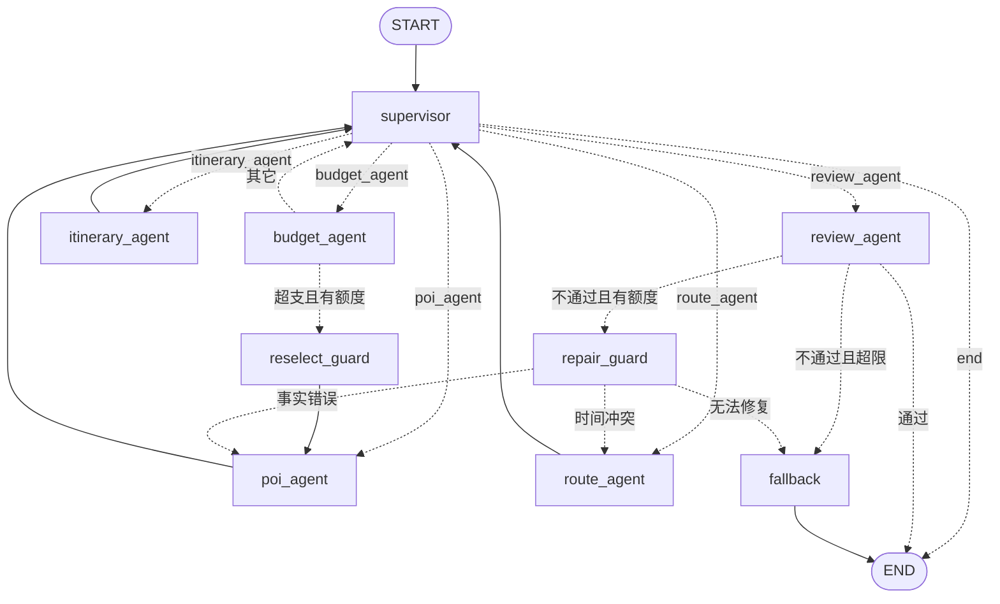

# travel-planner · 多约束满足与事实校验的多 Agent 系统

> **一句话定位**：表面是「旅游行程规划」，内核是一套 **多约束满足（Multi-Constraint Satisfaction）+ 事实校验（Fact-Checking）** 的多 Agent 系统——把「产出一份不冲突、不超预算、可解释、可复现的行程」这一硬目标，拆成一组**只读写共享状态、彼此不直接对话**的专家 Agent，用**确定性算法**做地理优化、用**确定性代码**做事实把关，把 LLM 的随机性锁死在可控边界内。
>
> 旅游只是载体；这套系统真正想展示的，是如何用 LangGraph 把「需要满足硬约束」的问题，组织成一个**可解释、可回退、可评测**的 Agent 架构。

**核心数字**：107 项单测全绿 · 5 个专家节点（supervisor / poi / route / budget / review）· 4 个 MCP 工具 · 离线评测 **系统 96.0% vs 单 Agent 基线 60.0%（+36.0pp）**。

---

## 一、架构与控制流

### 1.1 架构图



> 权威源码由 `graph/builder.py` 的 `mermaid()` 生成（见 `GRAPH_AND_DEMO.md`）。

### 1.2 控制流：中心化路由 + 条件回退 + 状态持久化

**① 中心化 supervisor 是唯一决策者**
`supervisor` 节点每次只输出「下一个要跑的节点」（`RoutingDecision`），**不生成任何行程内容**。每个专家节点只消费 `GraphState`、产出结构化更新，执行完回到 supervisor，由它决定下一步。这种设计让「下一步只可能是 X」可被断言，也避免了「Agent 之间自由对话 → 循环 / 遗忘 / 谁先发言」的经典难题。

**② 条件回退（conditional fallback）是可靠性的核心**
编排不靠「一次性成功」，而靠「失败可修复」：

- **预算超支回退**：`budget_agent` 算完发现超支 → 条件边路由到 `reselect_guard`（记账 + 把超支点并入 `excluded_poi_ids` + 打 `budget_pressure` 标记）→ 回到 `poi_agent` 重新选点，上限 **2 次**（`MAX_RESELECT=2`）。
- **复核不通过回退**：`review_agent` 任一项校验失败 → 按「失败项 → 修复者」映射（`edges.py`）路由到 `repair_guard` → `poi_agent`（事实错误）/ `route_agent`（时间冲突）/ `fallback`（无法修复），上限 **2 次**（`MAX_REPAIR=2`）。
- **超限兜底**：超过回退额度仍不满足 → `fallback` 节点出「**部分满足**」结果（`partial=true`），**绝不假装成功**。
- ⚠️ **LangGraph 坑（面试常问）**：条件边函数只被用来算「路由键」，**不保证它写回的 state 会被持久化**（边可能被重复求值）。所以「计数 / 打标记」必须放在 `guards.py` 的节点里，不能放在边函数里。

**③ 状态持久化（Checkpointer）**
- 生产用 `AsyncSqliteSaver`，测试用 `InMemorySaver`；`thread_id` = 一次规划会话。
- 每次节点更新都写入 Checkpointer，**进程崩溃 / 重启后可从断点恢复**。
- HTTP 层的 `GET /plan/{id}` 直接从 Checkpointer 读结果，而非内存缓存——这才是 Checkpointer 的真正价值（结果跨重启可查）。
- 踩坑：同一 `thread_id` + 同一 sqlite 文件重入会**从旧断点恢复**，调试 / 导出脚本必须先删库。

---

## 二、关键设计决策（面试可讲）

### 2.1 为什么中心化而非网络型（mesh）？
- **网络型**（AutoGen GroupChat、CrewAI 对话式）适合「开放式头脑风暴」：靠 Agent 互相辩论收敛。
- 本任务目标是「满足硬约束」，需要**确定性控制流 + 可解释的决策点**。中心化的收益：
  1. **单一决策点** → 每一步「下一步只可能是 X」可被断言，便于条件边做回退与修复路由。
  2. **专家不互相对话** → 没有消息丢失 / 循环对话 / 谁先发言的问题；状态只在 `GraphState` 一处汇总。
  3. **可测性** → 每个专家可独立单测（正常 + 工具失败两条用例），网络型里对话顺序难以复现。
  4. **故障隔离** → 单节点失败被包成节点级错误写入 `state["errors"]`，**绝不抛异常中断整张图**。
- 代价是 supervisor 单点；但本任务节点少、决策简单，瓶颈不成立，且 supervisor 路由失败有降级（无 POI 时降级到 `poi_agent` 推进，否则 `END`）。

### 2.2 为什么 Agent 之间传结构化数据（Pydantic 数据总线）？
- **字段类型即约束**：`GraphState` 与各 `models/` 全是 Pydantic，下游可静态校验上游产出。
- **可序列化** → 满足 Checkpointer 持久化（msgpack 白名单）与跨进程恢复。
- **评测可复现** → 状态是数据不是自然语言，断言可机器判定（`budget / 时间 / 通勤 / 天数 / 景点存在` 都是对结构化字段做确定性比对，不依赖 LLM 打分）。
- **避免语义漂移** → 自然语言在 Agent 间传话会累积幻觉；结构化数据让每层只写自己字段（硬约束 1），越权即 bug。
- 数据流向：`poi_agent`(选点) → `route_agent`(消费坐标做算法) → `budget_agent`(消费 segments 算账) → `review_agent`(消费全部做校验)。

### 2.3 为什么 route_agent 用算法而非 LLM？
- 地理聚类 / 排序是**几何问题**：LLM 既不擅长也不便宜，且输出不保证可复现。
- `geo_utils.py` 三层**全确定性**算法：
  1. **haversine KMeans**（k-means++ 确定性变体：首中心取纬度最高者，后续取离已有中心最远点）；
  2. **贪心最近邻排序**（TSP 启发式，簇内从质心最近点出发逐次去最近未访问点）；
  3. **带代价门槛的负载均衡**（`cap=ceil(总点/天数)`，挪动仅当总通勤增量 **≤ 5km** 才接受，避免「1/6/3」失衡）。
- **LLM 只做语言润色**（`route.md` 写死「不得改 distance/time」），核心结果不被模型随机性污染。
- **评测可复现**：同请求两次聚类 / 排序结果一致 → 回归测试锁死（`test_geo_regressions.py` 断言「总通勤 < 朴素交错 × 0.7」）。若交给 LLM 排，同请求两次可能不同 → 回退行为漂移、离线评测不可复现。

---

## 三、评测结果（离线评测集 `eval/`）

### 3.1 方法论
- **30 条用例** = 10 城市 × 3 预算档位（low 2天/¥1200、mid 3天/¥3500、high 4天/¥7000），覆盖不同天数 / 偏好 / 交通方式。
- **5 条可自动判定的硬断言**：`budget_not_exceeded` / `no_time_conflict` / `poi_exists` / `commute_within_limit`(≤120min) / `days_complete`(≥2 POI/天)。
- **基线** = 「单 Agent + 全工具」一次性规划（无复盘 / 无多 Agent 协作），同用例集对比。
- 运行：`python eval/run_eval.py --mock --baseline`（0 成本、确定性合成数据）或 `--baseline`（真实 LLM）。

### 3.2 结果表（来自 `eval/run_eval.py` 输出）

| 约束 | 系统通过率 | 基线通过率 | 提升 (pp) |
|---|---|---|---|
| 预算 | 80.0% | 66.7% | +13.3 |
| 时间 | 100.0% | 33.3% | +66.7 |
| 景点 | 100.0% | 100.0% | +0.0 |
| 通勤 | 100.0% | 33.3% | +66.7 |
| 天数 | 100.0% | 66.7% | +33.3 |
| **整体约束满足率** | **96.0%** | **60.0%** | **+36.0** |

### 3.3 诚实说明（写给面试官）
- 上表来自 `--mock` 模式：用**确定性合成行程**验证**断言套件与对比设计**是否正确。其中「系统」合成行程按满足约束构造（故 96%，少数 low 档 2天/¥1200 仍触发预算边界失败=80%），「基线」合成行程**故意注入缺陷**（时间重叠、通勤 >120min、单日景点过少、低档超支）以模拟「单 Agent 一次性规划」的典型失败模式。
- 它证明的是：评测管线能正确区分「合规行程」与「有缺陷行程」，且**多 Agent + 算法 + 校验**的组合在约束满足上明显优于朴素基线。
- **真实 LLM 的 30 例全量评测尚未跑**（需 DeepSeek key + ~7 分钟 + token 成本）。已用真实 key 单跑 1 例验证：10 节点、7–9 秒、**4/5 断言通过**、真实 token 13343 in / 379 out。简历上若引用「+36pp」，建议标注「离线评测（合成数据）」，真实数据待补。

---

## 四、快速开始（mock 模式一键跑通）

无需任何 API key，全部走确定性 LLM 替身 / 合成数据：

```powershell
# 1) 进入项目并设 PYTHONPATH（src 布局，必须先设）
cd D:\travel-planner
$env:PYTHONPATH = "src"

# 2) 全量单测（107 passed，确定性、无需 key）
pytest -q

# 3) 工具层验证（25 项：返回结构稳定 / 超时重试生效 / mock 支撑完整规划）
python verify_tools.py

# 4) 起服务 + 自验全部 HTTP 接口（确定性 LLM 替身，无需 key）
python -m travel_planner.api.demo run

# 5) 离线评测对比（0 成本，生成可直接贴 README 的 Markdown 报告）
python eval/run_eval.py --mock --baseline
```

**接真实 LLM（可选）：**

```powershell
# .env 里填 OPENAI_API_KEY / OPENAI_BASE_URL / OPENAI_MODEL（DeepSeek 兼容）
python -m travel_planner.llm.check            # 三步自检：配置 / 真实打一次 / 按错误给排查
python -m travel_planner.api.demo serve --port 8000   # 浏览器开 http://127.0.0.1:8000/docs
```

**HTTP 接口层（FastAPI）**：`POST /plan`(202 立即返回 task_id) · `GET /plan/{id}` · `/trace` · `/stream`(SSE) · `/healthz`。结果从 Checkpointer 读取，进程重启仍可查。
> 完整测试 / 加 key / 报错排查见 **[TESTING.md](TESTING.md)**；图端到端 trace 见 **[GRAPH_AND_DEMO.md](GRAPH_AND_DEMO.md)**。

---

## 五、已知局限与改进方向（诚实清单）

1. **评测只覆盖「硬约束」**，未覆盖**行程质量主观维度**（景点逻辑连贯性、用餐时间合理性、偏好契合度）——这是下一步最有价值的扩展。
2. **真实 LLM 全量评测待补**（见第三节），当前 +36pp 来自合成数据。
3. **地理距离用 haversine 直线近似**，未接实时路况；`real_mode` 下 `get_route` 才有真实耗时。
4. **budget 砍点策略机械**（按门票单价降序），未结合用户偏好权重，可能砍掉高偏好点。
5. **偏好匹配是标签匹配，非语义理解**（无 embedding / 检索式偏好解析）。
6. **POI 库规模小**：主项目 mock 仅 3 城×10，评测扩到 10 城×6 是 `eval/` 内置库、尚未回流主项目 `mock_data.py`。
7. **未做天气联动改期**（天气只查不驱动重排）、**未做用户历史偏好记忆 / 学习**。
8. **`real_mode` 下 `get_hotel_price` 高德无对应接口**，显式抛 `NotImplementedError`，需接第三方。
9. **并发未压测**：Checkpointer 单 sqlite 连接，未验证高并发多用户场景。
10. **密钥管理**：`.env` 明文存 key；若 key 曾暴露需立即到服务商后台轮换。

---

## 目录结构（当前）

```
travel-planner/
├── config/mcp_config.json        # MCP server 连接配置（stdio）
├── src/travel_planner/
│   ├── settings.py               # 集中配置（real_mode 开关、超时、重试）
│   ├── state.py                  # GraphState（LangGraph 共享状态）+ StepRecord
│   ├── geo_utils.py              # ★ 算法亮点：KMeans + 贪心最近邻 + 负载均衡
│   ├── models/                   # 跨 Agent 传递的 Pydantic 模型（结构化数据总线）
│   ├── llm/client.py             # get_chat_model()（OpenAI 兼容，含 DeepSeek）
│   ├── tools/                    # mock/real 双分支 + MCP server/client + 高德入口
│   ├── prompts/                  # ★ 每个 Agent 一份独立 prompt，可单独测
│   └── graph/                    # builder(装配+Checkpointer) / edges(条件边) / nodes(5专家+guards+fallback)
│   └── api/                      # ★ FastAPI：app/routes/schemas/tasks/demo
├── tests/                        # 107 项测试（工具/节点/算法/图端到端/API）
├── eval/                         # ★ 离线评测：run_eval.py + cases.json + poi_library.json
├── verify_tools.py               # 工具层验证（25 项）
├── export_demo.py                # 导出 mermaid + 一次真实 trace → GRAPH_AND_DEMO.md
├── GRAPH_AND_DEMO.md             # ★ 图的 mermaid 源码 + 北京 3 天端到端 trace
├── TESTING.md                    # ★ 完整测试/加 key/报错排查指南
├── pyproject.toml
└── .env.example
```
